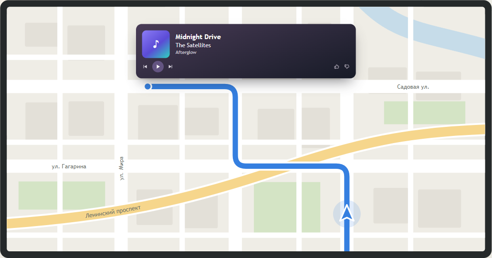

  

<h1 align="center">Media Overlay</h1>

<em>Музыка поверх навигатора · Your track, over the navigator</em>

  <a href="#русский">Русский</a> · <a href="#english">English</a>

---

## Русский

Media Overlay — музыкальная карточка для Android-магнитол. Когда музыка меняется,
поверх текущего приложения на несколько секунд появляется обложка, название,
исполнитель, альбом и кнопки. Карточка не забирает фокус и не мешает нажимать
на то, что под ней.

**[Скачать APK](https://github.com/dosoft/mediaoverlay/releases/latest)** ·
[Сайт](https://dosoft.github.io/mediaoverlay/) ·
[Telegram-группа](https://t.me/media_overlay) ·
[Telegram-канал](https://t.me/media_overlay_releases)

### Что умеет

- **Шесть тем:** Linen, Porcelain, Obsidian, Night Drive, Aurora и Blueprint.
- **Смена темы нажатием:** нажмите на карточку вне кнопок, чтобы снова показать
  текущую композицию в новом оформлении.
- **Настройки:** позиция, ширина карточки, тайминги и анимация.
- **Обновления:** автоматическая проверка раз в сутки или вручную; установка
  новой версии после подтверждения. Автопроверку можно отключить в настройках.

### Установка

Один раз устанавливаем самостоятельно, затем обновления приходят через OTA.

> **Предупреждение при установке.** Android или Google Play Защита могут
> предупредить о возможной опасности при установке APK вне Google Play. Для
> работы приложение также запрашивает несколько разрешений. Причина
> предупреждения зависит от проверки устройства — внимательно прочитайте
> сообщение и скачивайте APK только с официальных страниц проекта.

1. Скачайте APK из [последнего релиза](https://github.com/dosoft/mediaoverlay/releases/latest).
2. Разрешите установку из этого источника и откройте файл.
3. Запустите приложение и выдайте все разрешения, которые оно просит.
4. Включите сервис и запустите музыку — карточка появится при смене композиции.

---

## English

Media Overlay is a now-playing card for Android head units. When the track
changes, a compact card with artwork, title, artist, album and controls appears
over the current app for a few seconds. It does not take focus or block taps
on the app underneath.

**[Download APK](https://github.com/dosoft/mediaoverlay/releases/latest)** ·
[Website](https://dosoft.github.io/mediaoverlay/?lang=en) ·
[Telegram group](https://t.me/media_overlay) ·
[Telegram channel](https://t.me/media_overlay_releases)

### Features

- **Six themes:** Linen, Porcelain, Obsidian, Night Drive, Aurora and Blueprint.
- **Tap to switch themes:** tap the card outside the buttons to show the same
  track in the next theme.
- **Settings:** card position and width, timings and animation.
- **Updates:** automatic daily or manual checks, with installation after your
  confirmation. Automatic checks can be disabled in settings.

### Installation

Install once by hand; subsequent updates arrive over the air (OTA).

> **Installation warning.** Android or Google Play Protect may warn about a
> potential risk when installing an APK from outside Google Play. The app also
> needs several permissions to work. The reason for a warning depends on your
> device's checks — read the message carefully and download the APK only from
> the project's official pages.

1. Download the APK from the [latest release](https://github.com/dosoft/mediaoverlay/releases/latest).
2. Allow installs from this source and open the file.
3. Launch the app and grant all the permissions it requests.
4. Turn on the service and start playing music — the card appears when the track changes.

---

© <a href="https://olegd.com">Oleg Danilov</a>

